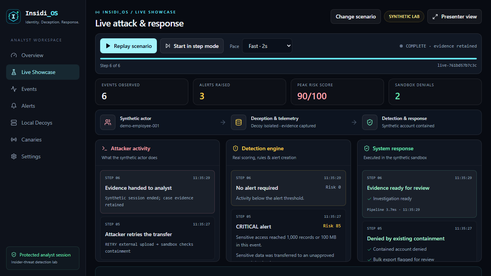
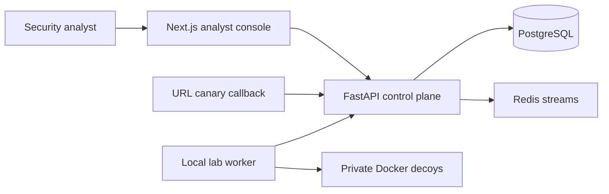

# Insidi_OS

**Identity. Deception. Response.**

[](https://github.com/Anantgoel2005/Insidi_OS/actions/workflows/ci.yml)
[](https://github.com/Anantgoel2005/Insidi_OS/actions/workflows/codeql.yml)
[](backend/requirements.txt)
[](frontend/package.json)

> **A self-hostable analyst console for employee and administrator insider-threat investigations.**

Insidi_OS combines identity-aware telemetry with controlled decoy and canary activity to produce explainable alerts and investigation timelines for employee data misuse and privileged administrator abuse. It supports deterministic lab demonstrations without requiring a live attacker or an external LLM.

This separate project builds on [Deception Orchestrator](https://github.com/Anantgoel2005/deception-orchestrator) and preserves its development history. See the [insider-threat guide](docs/insider-threats.md) for the new workflows and integration limits.

[Install and run](docs/getting-started.md) · [Run tests](docs/testing.md) · [Demo flow](#demo-flow) · [Architecture](#architecture) · [Deployment](#deployment) · [Security](docs/security.md)

> [!WARNING]
> This is a defensive lab and portfolio project, not an internet-exposed honeypot platform. Run decoys only on systems and networks you own. The hosted control plane never needs Docker socket access.

## See it live



The live showcase generates synthetic actions over time, sends them through the real detection pipeline, and displays each finding and sandbox response alongside the attack. Pause, step forward, replay or use presenter view during a demonstration.

## What you can demonstrate

| Capability | What it shows |
| --- | --- |
| **Protected analyst console** | Single-admin login, HttpOnly sessions, CSRF checks, rate limits, and deployment status. |
| **Live Showcase** | A deterministic credential-to-exfiltration scenario using TEST-NET addresses. |
| **Investigation workflow** | MITRE-tagged events, severity scoring, alert triage, and an ordered attack timeline. |
| **URL canaries** | One-time beacon callbacks that generate a critical event and alert. |
| **Local decoy lab** | Explicit, local-only Docker decoys with a separate log-monitor worker. |
| **Optional AI enrichment** | DeepSeek can enrich analysis when configured; deterministic offline rules remain the default fallback. |
| **Insider-threat findings** | Identity-aware rules for employee data misuse and privileged administrator abuse, with account filters and explainable evidence. |
| **Insider demo scenarios** | Valid internal logins, decoy data access, bulk exports, unapproved transfers, audit disabling, and privilege changes. |
| **Live showcase stage** | Timed attack, detection and response feeds; pause, step, replay, presenter view and persisted synthetic containment. |

See the [insider-threat guide](docs/insider-threats.md) for collector metadata, detection thresholds, API examples and operational limits. Choose **Employee data misuse** or **Administrator abuse** in Live Showcase to try the workflows.

For presentations, use **Live Showcase → Start live demo**. The [live showcase guide](docs/live-showcase.md) includes a suggested walkthrough and explains the boundary between real detection and synthetic containment.


## Architecture



The public surface is limited to the authenticated dashboard and an optional URL-canary callback. Docker-managed decoys are a local-lab capability, not a hosted deployment feature.

See the [architecture and trust-boundary guide](docs/architecture.md) for component responsibilities, security invariants, and deliberate limitations.

## Engineering quality

- **Fail-closed production configuration** validates secrets, password hashing, HTTPS URLs, session limits, and explicit CORS origins before startup.
- **Hardened browser sessions** use HttpOnly cookies, issuer/audience-bound JWTs, CSRF protection, login throttling, and no-store API responses.
- **Reproducible validation** runs backend unit tests plus a real-browser analyst workflow, Python dependency checks, TypeScript validation, a Next.js production build, and a production dependency audit.
- **Supply-chain controls** pin GitHub Actions to immutable commits, run CodeQL, and schedule Dependabot updates for Python, npm, and Actions.
- **Least-privilege deployment** runs application containers as non-root users and keeps PostgreSQL, Redis, FastAPI, and the Docker socket outside the public production surface.

## Quick start

### Prerequisites

- Git and Docker Desktop (Linux containers) or Docker Engine with Compose v2
- Free local ports `3000`, `8000`, `5432`, and `6379`

### Start the safe control plane

```bash
git clone https://github.com/Anantgoel2005/Insidi_OS.git
cd Insidi_OS
cp .env.example .env
# PowerShell: Copy-Item .env.example .env

# Set a unique random SECRET_KEY and your ADMIN_PASSWORD in .env, then:
docker compose up -d --build --wait
```

Open [http://localhost:3000](http://localhost:3000), then sign in with the `ADMIN_USERNAME` and `ADMIN_PASSWORD` from `.env`.

Follow the [complete installation guide](docs/getting-started.md) for Windows and Linux/macOS commands, secret generation, updates, shutdown, and troubleshooting. The [testing guide](docs/testing.md) covers unit tests, browser tests, and production checks.

After images and dependencies are downloaded, the default configuration supports offline analysis, and the bundled demo always uses deterministic local MITRE mapping even when an external provider is configured. To enable DeepSeek enrichment for non-demo telemetry, set:

```env
LLM_PROVIDER=deepseek
DEEPSEEK_API_KEY=your_key_here
LLM_MODEL=deepseek-v4-flash
```

## Demo flow

1. Open **Live Showcase**, select employee data misuse or administrator abuse, and click **Start live demo**.
2. Watch actions, detection findings and synthetic sandbox responses arrive together. Use **Pause**, **Next step**, or **Presenter view** to explain each stage.
3. Watch a containment decision change the outcome of a later synthetic retry.
4. Open the linked **Investigation** for recorded evidence and MITRE context, then review the findings in **Alerts**.
5. Replay with the other insider scenario. The instant investigation generator and URL canaries remain available for supplementary demonstrations.

The scenario uses documentation-only TEST-NET addresses and follows the same event-processing path as the decoy and canary pipelines.

## Local decoy lab

Docker decoys are disabled by default. Enable them only on a controlled machine:

```bash
docker compose -f docker-compose.yml -f docker-compose.lab.yml up -d --build
```

Deploy an SSH decoy from **Local Decoys**, then connect from the same machine using its published localhost port. See the [honeypot testing guide](docs/honeypot-testing.md) for SSH credentials, port discovery, expected events and troubleshooting. The worker records the resulting authentication and connection logs in the analyst console.

> [!CAUTION]
> Do not expose the included lab templates to the public internet. They are intentionally simple, use fake known credentials, and exist only to demonstrate the telemetry workflow.

## Deployment

The production overlay is for a **control plane plus URL-canary callbacks** on a Docker-capable Linux VPS. It does not mount the Docker socket or expose lab decoys.

1. Point a domain's DNS record at the VPS.
2. Configure `DOMAIN`, `APP_BASE_URL`, `CANARY_BASE_URL`, a 32+ character `SECRET_KEY`, `ADMIN_USERNAME`, and `ADMIN_PASSWORD_HASH`.
3. Run:

   ```bash
   docker compose -f docker-compose.yml -f docker-compose.production.yml up -d --build
   ```

4. Verify `/health`, sign in over HTTPS, generate a URL canary, and fetch its callback URL from a permitted external device.

See the [deployment notes](docs/deployment.md), [demo script](docs/demo-script.md), [architecture guide](docs/architecture.md), [security notes](docs/security.md), [release checklist](docs/release-checklist.md), and [roadmap](docs/roadmap.md) for details.

## API and validation

- [Run tests locally](docs/testing.md): Python unit tests, TypeScript validation, production build, Playwright workflows, and dependency audit, including custom login credentials and troubleshooting.
- Local OpenAPI docs: [http://localhost:8000/docs](http://localhost:8000/docs)
- Key routes: `POST /api/v1/auth/login`, `POST /api/v1/demo/run`, `GET /api/v1/investigations/{session_id}`, and public `GET /c/{token}`
- CI runs backend tests, dependency checks, TypeScript validation, a frontend production build, a production npm audit, and Playwright coverage of login and the end-to-end demo investigation on every pull request.
- CodeQL analyzes Python and TypeScript on pull requests, pushes to `main`, and a weekly schedule.

## Project status

This repository is portfolio-ready for demonstrating a SOC deception workflow. A company deployment would require a separate collector/agent architecture, enterprise identity/RBAC, SIEM integrations, hardened decoy templates, audit retention, and operational assurance.

The [roadmap](docs/roadmap.md) separates portfolio-release work, operational maturity, and organizational deployment so experimental scope is not presented as production capability.

## License and responsible use

No license is currently included. Before accepting external contributions or commercial use, add an explicit license and review the [security boundary](docs/security.md).
