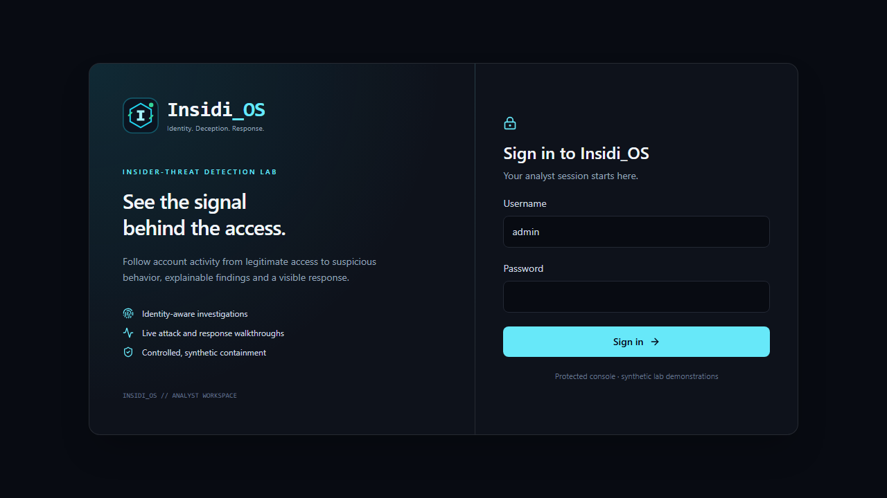

# Insidi_OS identity

Use **Insidi_OS** exactly: capital I, lowercase nsidi, an underscore, and uppercase OS. The repository is [Anantgoel2005/Insidi_OS](https://github.com/Anantgoel2005/Insidi_OS). Package and technical identifiers use `insidi-os` where lowercase names are required.

The descriptor is **Insider-threat detection lab**. The tagline is **Identity. Deception. Response.** The product brings together account context, controlled decoy telemetry, explainable findings, and live demonstrations of synthetic response.

The vector mark combines an I-shaped core, a hexagonal boundary and a green signal point. Its native SVG lives at `frontend/public/brand/insidi-mark.svg`; the favicon is `frontend/public/icon.svg`. `Brand` renders the shared wordmark and descriptor. Product strings and repository URL live in `frontend/src/lib/brand.ts`.

| Color | Use | Hex |
| --- | --- | --- |
| Signal cyan | Brand, primary controls, selected navigation | `#22d3ee` |
| Ice cyan | Wordmark accent, readable primary controls | `#a5f3fc` |
| Response green | Verified responses and containment state | `#34d399` |
| Slate | Surfaces, structure, secondary text | `#0b1420` |

The stage reserves rose for synthetic attacker activity, amber for findings and green for responses. The lab label remains visible. Describe events and alerts as real backend records, and containment as synthetic sandbox controls.

The rebrand preserves existing database tables, persisted demo evidence, Redis stream names and JWT issuer/audience values for compatibility. These are implementation identifiers rather than product branding. Historical attribution and original release history continue to name Deception Orchestrator.
